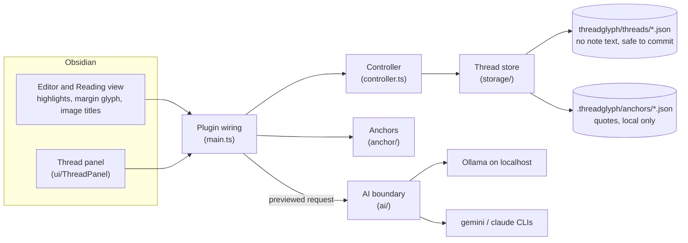

# Architecture

How Threadglyph is put together, and the rules each part keeps. For the user-facing view of the same rules, see the README's [Where data lives](../README.md#where-data-lives) and [Disclosures](../README.md#disclosures).

## Parts

| Folder | Role |
|---|---|
| `src/model/` | Thread and message types and pure operations on them (reply, edit with history, resolve, delete). No Obsidian imports. |
| `src/anchor/` | Captures a selection as a quote plus 64 characters of context on each side, and finds it again in the current note text. Also parses image embeds. |
| `src/storage/` | Reads and writes threads and anchors, validates every record, and runs a per-thread queue so two quick actions can't overwrite each other. Backup and restore. |
| `src/controller.ts` | The commands the panel and editor call (comment, reply, edit, resolve, delete), and pending selections and drafts. |
| `src/ui/` | The thread panel, editor and Reading-view decorations, modals, and the legacy `@agent` views. |
| `src/ai/` | One provider-neutral boundary (`types.ts`) with three adapters: Ollama over HTTP, and the Gemini and Claude command-line tools as child processes. Also builds the request and the preview. |
| `src/agent/` | Legacy `@agent`: turns a reply into a checked proposal, shows it as a diff, and applies it only on Accept. |
| `src/import/` | Read-only import of Agent Comments' `{==…==}{>>…<<}` markup. |
| `src/main.ts` | Obsidian wiring: commands, views, settings, file events, and the glue between the parts above. |

## How an anchor is found again

1. Find every place the quote occurs in the note.
2. **No match:** the thread is shown as *missing*, with **Reattach to selection**.
3. **One match:** found.
4. **Several matches:** rank them by how much of the saved context still surrounds each one. A tie is reported as *ambiguous*, never guessed. Line numbers are not used to break ties, because they shift with ordinary edits.

Rebuilding a note's anchors runs after edits (debounced 300 ms), not on each keystroke. Measured costs are in [compatibility.md](compatibility.md).

## Rules the code keeps

- **Notes are read, not written.** The only path that changes a note is Accept on a previewed `@agent` proposal: one undoable edit, refused if the text changed since the preview.
- **Tracked files hold no note text.** Quotes, context and image paths live only in `.threadglyph/`. Agent proposals, which hold note text, stay in memory and are never saved.
- **Nothing is sent without a preview.** Every AI request is built first, shown with its destination and exact text, and only then sent.
- **External tools are fenced in.** The CLIs run without a shell, get the request on stdin, and have their tools, MCP servers and settings files turned off. Threadglyph never reads API keys.
- **Data is validated on the way in.** Every thread, anchor and backup record is checked against its schema; invalid records are skipped and reported, never half-loaded.

## Tests

`npm run check` runs about 420 tests with coverage around 99%. UI tests run in happy-dom against a small Obsidian stand-in (`tests/obsidianStub.ts`). Plugin tests drive the real plugin class against an in-memory vault and workspace, with a real CodeMirror editor. Behavior inside the Obsidian app is checked by hand in a disposable sandbox vault (`npm run sandbox`).
